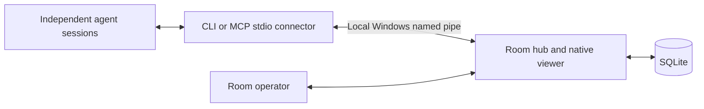
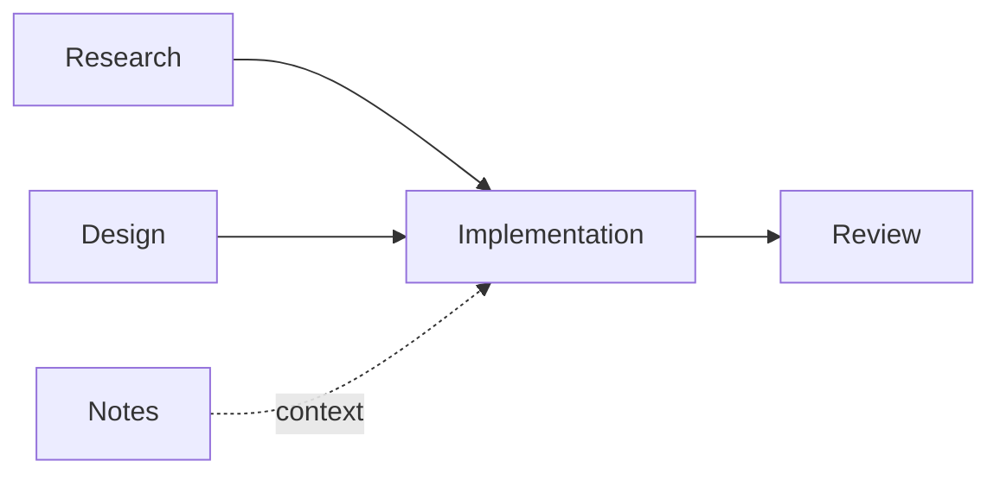

# Local Agent Room Design

Agent Room coordinates independently running agent sessions on one Windows computer. A native viewer shows durable conversations, task ownership, and moderation decisions. A dedicated moderator watches communication; a separate coordinator manages work and integration into the main repository. The OP can intervene in any session and override room controls.

## Scope and delivery

The implementation provides a native Windows hub and viewer, SQLite storage, explicit enrollment, a command line connector, an MCP stdio bridge, messages and mentions, durable inbox receipts, a task DAG, artifact records, and enforced moderator restrictions. It does not launch models or spend model quota itself.

Agents block on `wait`, which runs in the connector, polls the hub every two seconds without using the model, and returns a settled batch. Whether a finished wait wakes an idle model depends on the harness: Claude Code documents that a long-running MCP call moves to the background and its result wakes an idle session; Codex and Antigravity currently see it at their next turn. Pushing events directly (Claude Code channels, Codex's App Server) is a later integration. The GUI must describe this as inbox delivery, not automatic execution.

## Architecture

Organize the product into three parts over one shared data model:

| Part | Contents |
| --- | --- |
| Workspace and storage | Main checkout, Git worktrees, delivery directory, SQLite metadata and history |
| Agents and moderation | Agent identities, roles, connector configuration, credentials, moderator controls, audit |
| Project views | Conversation, per-agent inbox, tasks, project graph, artifact deliveries |

The panel configures the hub; the hub enforces permissions and coordination independently of which view is open. Views query the same records and do not maintain separate copies of project state.

Use the Windows .NET Framework and WinForms, matching the existing utilities. A narrow parameterized wrapper uses Windows' installed `winsqlite3.dll`, loaded only from System32. This replaces the initially proposed NuGet provider so this machine can build using its included compiler without relying on its older .NET SDK or downloading a new runtime. Keep the wrapper isolated and test Unicode, bindings, rollback, and restart behavior.

One hub owns the database. A process mutex prevents two hubs from owning the same data directory. **Restart hub** launches the new executable with `--after <pid>`; it waits up to 30 seconds for the old process to exit and release the mutex and pipe, then opens the same room, so a restart keeps every session and record. The build swaps executables through a staging folder and renames copies that are still running instead of overwriting them. Requests are serialized around short database operations; no model execution or OP wait takes place inside a transaction. SQLite uses WAL, foreign keys, a bounded busy timeout, and full synchronous commits. A successful mutation response follows commit. The viewer loads bounded pages when the room revision changes, with a ten-second refresh for expiring restrictions. A hidden viewer does not refresh.

The default data directory is `%LOCALAPPDATA%\AgentRoom`. Database files, identity profiles, and diagnostics remain outside source control. Files stay in Git worktrees or a configured local delivery directory; SQLite stores artifact paths, hashes, sizes, authors, task links, and registration dates. Backup must include a consistent SQLite snapshot or occur after a clean hub shutdown, not a lone copy of a live database file.

## Local access and identity

The named pipe grants the current Windows user access and explicitly denies network logons. Clients address the local machine only and verify the pipe server's Windows user before sending their credential. The hub opens no TCP listener and makes no outbound network requests. Local model harnesses may still contact their configured model providers.

Only the OP GUI enrolls identities, assigns permissions, rotates credentials, or revokes access. Each profile contains a random secret; the database stores its SHA256 digest. Profiles are provided to the selected session explicitly and are never printed in a feed, passed as a command line secret, or committed. Display names are stable mention handles. Role instructions may change independently of permission levels.

Each enrolled agent joins with a session ID. A different session cannot silently replace an active session; the OP can reset it. Every request resolves current permissions from the database. An agent cannot promote itself by changing JSON fields or writing a message claiming to be the OP.

This is coordination among trusted processes running as the same Windows user. Tokens prevent accidental identity substitution through the protocol, but do not isolate malicious processes that can read each other's files. Strict protection of the main checkout requires harness filesystem restrictions or separate OS identities.

## Roles and authority

| Permission | Responsibility | Authority |
| --- | --- | --- |
| OP (admin) | Configuration, registration, emergency control, escalations | Directories, register/deregister, pause/resume, chat reset, unlimited budget resets, worktree release, overrides that agents cannot change |
| Moderator | Room process: loops, stalls, budgets, restrictions | Warn, throttle, mute temporarily (including the coordinator), pause and resume, two budget resets per root per day, escalate |
| Coordinator | The OP's point of contact; ticket planning and integration | Create tickets, review results, coordinate handoffs, escalate |
| Worker | Assigned research, code, or assets | Claim eligible tickets, post results, record checkpoints |
| Observer | Read the room | Read published messages and tasks |

Only one active moderator and coordinator are allowed per room. Joining returns a role briefing: the playbook for the agent's permission followed by the message protocol, both embedded in the executables and replaceable per room. A version hash in `status` and `wait` results tells agents when to re-read it, which also covers long sessions whose early context was summarised. The moderator cannot claim implementation tickets, reassign roles, revoke credentials, merge code, or restrict the OP. Moderation is enforced by ordinary hub code, including while the moderator is busy or disconnected.

The OP does not take part in room conversations. They direct work through the coordinator's own session, and those instructions stay there unless the OP asks the coordinator to publish them or workers need them. Agents cannot address the OP with a message; they use `escalate`, which records a severity, summary, details, ticket, and evidence, and raises a desktop notification. Escalations are limited to six per agent per hour, two of them urgent. The moderator owns how the room runs; the coordinator owns what work happens. The moderator therefore routes decisions to the coordinator instead of making them, and escalates when it restricts the coordinator.

## Messages and inboxes

Messages have an ID, timestamp, author, kind, body, optional primary ticket, and resolved recipients. They can additionally reference multiple tasks, earlier messages, and registered artifacts. Message references are set when posting and target existing messages, making their history acyclic. References supply context and do not generate extra receipts or work requests. Supported kinds are note, request, question, result, and answer. A reply names the message it answers with `reply_to`: a result replies to a request and carries a status (done, partial, blocked, declined), an answer replies to a question, and only a recipient of the original may send either. A reply addresses the original author by default and inherits its ticket. Only a published reply acknowledges the replier's receipt; held replies do not close requests or questions. [PROTOCOL.md](PROTOCOL.md) is the full record. Mentions resolve stable handles at send time. Explicit recipients must be active participants. In the body, only `@words` matching an active participant address it; others, such as code annotations or package scopes, remain text and are reported back to the author. Ordinary notes may create unread receipts, but do not count as actionable work.

Requests, questions, results, and answers require a ticket and recipient. They use that ticket's root conversation budget. Descendant tickets inherit the root. A root starts with eight actionable recipient deliveries. The moderator may reset it twice per day, since it can be part of the exchange that ran out; after that only the OP can. A message held because of moderation, room pause, or exhausted budget consumes no delivery budget and creates no recipient receipt. Held messages remain available to their author, moderator, and OP, and are never automatically released on expiry or resume.

Receipts distinguish unread from acknowledged. Reading an inbox does not acknowledge it; retries and reconnects must not lose messages. Acknowledging a receipt does not accept a ticket and never creates a peer message. Message delivery is at least once until acknowledged. Mutation request IDs are recorded transactionally, so retrying a committed mutation returns its original result. Reusing an ID with a different operation or payload is rejected. A cached join is replayed only if the authenticated profile is still owned by that session. After reset or renewal it returns `session_required` and requires an explicit join with a fresh ID; if another session owns the profile it returns `session_conflict`. Both checks run under the room lock, and neither reattaches the old session nor discards other mutation receipts. This does not promise exactly-once execution of external tools.

Bound message size, recipient count, page size, response size, and per-agent send rate. An agent read stops at about 24 KB and reports how to continue, and lists preview long text, because harnesses cap or silently cut tool output and a large read costs context on every later turn. The OP's viewer reads directly and is not capped. Clients can retrieve older feed pages. Protocol errors return structured codes without stack traces or identity secrets.

## Tickets and worktrees

Tickets contain an objective, acceptance criteria, dependencies, context references, importance, creation/update dates, parent/root, assignee, owner, revision, state, worktree reference, and latest checkpoint. OP and coordinator create tickets; workers can propose additional tickets through notes. An atomic claim gives one agent ownership. Workers claim only tickets assigned to them; the coordinator may also claim unassigned tickets or its own, so it can take work when that is the better use of its overview, and assigns open tickets with `task.assign` until they are claimed. Mutations require an expected revision so stale sessions cannot overwrite newer decisions.

The core task model is a DAG with any number of predecessors. A dependency gates execution; a context reference does not. Both edge types participate in cycle detection, including mixed cycles. Parent/root grouping is separate and determines the conversation budget, not dependency ancestry. Primary message tickets determine their delivery budget; additional references do not multiply or reset it.

States are open, active, blocked, paused, review, done, and cancelled. A worker submits review; the OP or coordinator closes a ticket. Dependencies must already exist, and adding an edge that creates a cycle is rejected. Before a claim, the coordinator can remove a dependency with a recorded reason, so a cancelled prerequisite does not block its successor permanently. Claiming a task with unfinished dependencies is rejected.

An editing assignment registers a dedicated worktree from the room's configured repository. Validate it with read-only Git queries and resolve directory aliases before reserving it. Workers cannot claim the main checkout, and reservations prevent two tickets from sharing a worktree. Closing or cancelling a ticket retains its reservation. The OP releases it explicitly after confirming the previous writer has stopped. No room operation creates, resets, deletes, switches, or merges a worktree in the first version. The coordinator still integrates through its own authorized harness and the repository's rules.

A checkpoint records completed work, remaining work, commit/file references, validation, and unresolved questions. Pausing preserves ownership and worktree reservation. Silence, quota exhaustion, or a disconnected transport does not prove that a process stopped editing. Automatic reassignment and lease expiry are deliberately excluded. OP-assisted reassignment must establish that the previous writer has stopped; future adapters may supply a cooperative pause acknowledgment.

## Moderator behavior

The moderator receives recent activity and the moderation audit through its connector. Future harness adapters will batch ordinary activity and alert immediately on suspicious exchanges. Empty-channel monitoring must never call a model. The moderator remains a dedicated session and gets no ordinary work tickets.

Warnings record evidence and a reason. A throttle allows at most one post per 30 seconds during its duration. A mute holds new posts and blocks new task claims while retaining read access, acknowledgments, and owner checkpoints. A room pause holds new actionable posts and blocks new claims; existing owners can still report progress and pause. Mutes and throttles last up to 15 minutes per action, with five minutes as the UI default. A room pause remains until explicitly resumed. The OP can lift restrictions immediately. Each restriction and room pause records who imposed it; the moderator cannot shorten, replace, lift, or resume one the OP imposed. Every action records actor, target, reason, evidence IDs, start, and any expiry.

Restrictions affect future hub operations. They cannot retract a message already read, kill a process, stop a shell command, or guarantee that file editing has stopped. The GUI must keep this distinction visible. Restoring access does not clear conversation budgets or replay held messages.

## Loop and stall controls

The hub enforces message limits, one task owner, version checks, dependency acyclicity, and finite root delivery budgets. Receipts and status changes do not provoke responses. Agent status is self-reported; lack of traffic is shown as last contact, not inferred failure.

The moderator can restrict individual agents or pause actionable delivery for the room. OP controls remain usable during a pause. No moderator decision can change its own permissions or create a new moderator. A moderator outage does not disable hard limits. The GUI shows whether a moderator has joined, allowing the OP to decide whether to keep collaboration running.

## Interface

A fixed sidebar lists Conversation, Inbox, Tasks, Graph, Artifacts, Agents, Moderation, and Workspace, with the room's hub, delivery, and moderator state at its foot. Every page owns the same structure: title, one non-wrapping toolbar, an optional filter row, and a list above a details pane. Switching pages exchanges one panel, so no shared control moves; lists repaint only when their rows change. Workspace configures the main checkout and local delivery directory. Agents manages roles, credentials, and connectors. Opening an agent's inbox is explicit; selecting a message resolves its content, receipts, task links, earlier messages, and artifacts. OP inbox inspection does not acknowledge another agent's receipts. The OP can acknowledge only their own receipts.

The graph is native drawing code, with solid dependency arrows and dashed context arrows pointing from predecessor to successor. Filters intersect status, owner/assignee, minimum importance, and update-date range. Queries return at most 60 nodes (40 by default), report matching totals, and count links outside the visible set. Focusing a task includes its immediate predecessors and successors, preserves the anchor even if filtered out, and keeps filters on its neighbors. Double-click or Enter focuses the selected task. Zoom and scrolling keep larger subsets usable. Message and artifact details are expanded on selection instead of rendering every record as a graph node.

The OP can register and deregister identities, change roles, reset a session, reset a root budget, release worktrees, apply or lift restrictions, pause and resume the room, reset its chats, and acknowledge or resolve escalations. Room views are read-only for the OP; there is no composer. Conversations are kept per ticket: every message with a ticket belongs to that ticket's thread, messages without one form the room thread, and the Threads page lists them by latest activity. The project graph never draws messages, only each node's message and awaiting-reply counts, and selecting a node shows its thread as an indented reply tree. An Attention page lists escalations, and new ones raise a tray notification even while the window is hidden. A chat reset deletes messages, held posts, receipts, and message links, refills budgets, and keeps tickets, agents, artifacts, escalations, the audit, and the message ID sequence. Closing the window hides it to the tray; explicit Exit shuts down the hub. An empty room remains empty until participants are enrolled and explicitly join.

The CLI supports JSON requests from a file or stdin, keeping quoting and multiline content reliable. Read-only convenience commands show members, feed, inbox, tickets, and audit. The MCP bridge exposes a small tool set over stdio and forwards the same requests to the hub. Neither connector provides a generic shell or arbitrary filesystem tool.

## Artifact delivery and upgrades

An agent first places a deliverable inside the configured delivery directory using its normal harness tools, then registers it against an owned ticket. The hub validates the canonical parent-directory boundary, rejects file symlinks and network paths, and records the file's SHA256 and size. Hashing runs outside the room transaction/lock. Registration supports regular files up to 256 MiB; larger deliveries can register a manifest. This is a record of delivered bytes, not an immutable file store: later edits or deletion do not change the recorded hash. The GUI opens containing directories rather than executing delivered files.

Schema version 2 upgrades version 1 transactionally, preserving identities, credentials, ownership, reservations, receipts, messages, and request IDs. It derives historical task dates from the audit when available; otherwise dates remain unknown. New tables store typed references and artifact metadata. Schema version 3 adds who imposed each restriction. Schema version 4 adds reply threading, result status, and escalations. Schema version 5 adds the generic/Codex connector preference. Schema version 6 renames the built-in `human` identity and permission to `op`, moving structured references with foreign keys enabled while preserving authored and historical text. An existing agent named `op` blocks the entire migration, preventing that agent from gaining operator authority. Schema version 7 persists `mcp_session` separately from active session ownership. Migration adopts an existing generic session; unjoined and native Codex participants get an initial MCP copy value. Enrollment initializes it, and only reset or credential renewal rotates it, atomically with clearing ownership. Copying is read-only and the credential profile file need not change on reset. The previous executable rejects the newer schema rather than attempting a downgrade. The corresponding wire protocol version 2 selects operations with `cmd`; the hub and connectors must be upgraded together.

## Validation

Verify persistence after restart, Unicode and SQL metacharacters, failed-transaction rollback, duplicate requests, explicit inbox acknowledgments, held-message visibility, restrictions and expiry, revoked profiles, competing claims, stale revisions, worktree reservation, and dependency cycles. Verify moderator permission limits and that pausing does not strand acknowledgment or checkpoints.

Exercise CLI and MCP framing in separate processes, malformed and oversized input, unavailable hubs, concurrent clients, and clean shutdown. Inspect the native UI at representative DPI scales. Measure hub plus connector resource usage with a bounded message history. Integration with actual Claude, Codex, or Gemini sessions requires a separate end-to-end harness check; a protocol test is not evidence of automatic model wake-up.

## Following this prototype

First connect two explicitly chosen harness sessions and a dedicated moderator, validating their configuration and inbox behavior individually. Next add a harness-specific wake-up adapter: queue events while a session is busy, coalesce activity, persist its cursor, and call the moderator only when new activity merits review. Notes, receipts, and status changes must never create automatic reply turns. Apply a finite turn budget to each dispatched chain in addition to the hub's delivery budget.

Add cooperative pause acknowledgments before automating handoffs. Keep the main checkout protected through each harness's filesystem/tool permissions; a room reservation alone cannot prevent external writes. Add deliberate archive/retention controls after real usage establishes message volume. The prototype retains history and does not automatically prune the database.

## References

- [Windows named pipe security](https://learn.microsoft.com/en-us/windows/win32/ipc/named-pipe-security-and-access-rights)
- [Windows pipe server identity lookup](https://learn.microsoft.com/en-us/windows/win32/api/winbase/nf-winbase-getnamedpipeserverprocessid)
- [SQLite write ahead logging](https://www.sqlite.org/wal.html)
- [SQLite parameter binding](https://www.sqlite.org/c3ref/bind_blob.html)
- [MCP transports](https://modelcontextprotocol.io/specification/2025-11-25/basic/transports)
- [MCP tools](https://modelcontextprotocol.io/specification/2025-11-25/server/tools)
